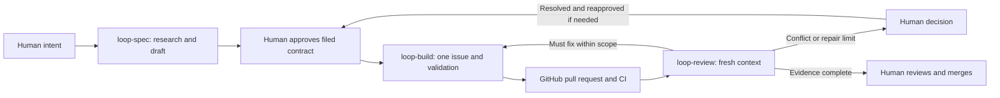
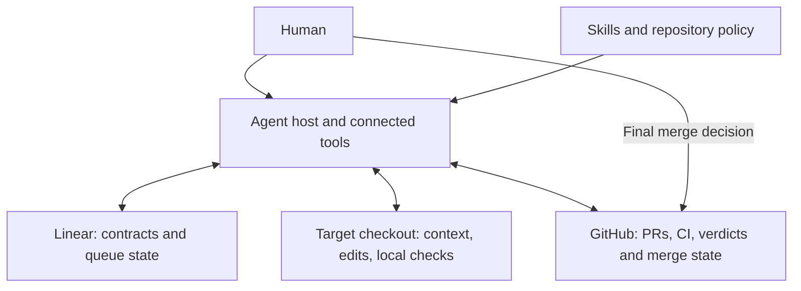

# AI Build Loop

[](https://github.com/awekisa/ai-build-loop/actions/workflows/validate.yml)

A portable set of agent workflows for turning a requirement into a scoped, tested pull request. A specification agent researches the repository and writes a Linear contract; a builder implements approved work; a separate reviewer checks the current commit against that contract and required CI. Humans own intent, specification approval, scope decisions, and final merge. The package contains instructions, an installer, and package tests; execution is provided by the agent host and its connected tools.

**Start here:** [real feature case study](docs/demo/README.md) · [architecture](docs/architecture.md) · [portfolio summary](docs/portfolio-summary.md)

## Why I Built It

Delegating code changes creates problems beyond generating code: a vague request can become an oversized change, context can disappear between sessions, and a passing test run can be mistaken for permission to merge. This project makes the work contract and handoffs explicit. Acceptance criteria and non-goals live in Linear; code, checks, and review evidence live in GitHub. Each agent has a bounded responsibility and a defined point at which it must return a decision to a person.

## How It Works



The diagram is the **prescribed workflow**. The skills instruct the host agent to perform these steps; there is no bundled queue daemon, lock service, or workflow engine. Specification is interactive. Build and review each process one unit per invocation. A host scheduler can invoke them again, but no scheduler is installed by this package. See the [operating contract](docs/workflow.md).

## Example Workflow

An owner wanted agents to use an existing application without sharing an account password. The work was split into credentials, user-facing MCP tools, and admin tools. The first feature added named, expiring, revocable account tokens and tests for ownership and authorization.

The resulting [PredictionsProject PR #32](https://github.com/awekisa/PredictionsProject/pull/32) maps six acceptance criteria to implementation evidence. Its author reported 63 passing backend tests and 12 targeted browser cases; [GitHub CI](https://github.com/awekisa/PredictionsProject/actions/runs/35569052700) independently records successful backend and frontend jobs. The local task record also captures a test-host compatibility failure and correction.

This is a real use of the spec/build skills, with deviations: the owner directly instructed implementation without the normal readiness label, and no independent loop-review verdict was found. The PR was merged by the owner's GitHub account; that metadata alone does not prove who operated the merge. The [demo evidence ledger](docs/demo/README.md) separates public evidence, local execution evidence, and missing gates.

## Architecture

| Component | Responsibility |
| --- | --- |
| [`loop-spec`](.agents/skills/loop-spec/SKILL.md) | Research, interview, define `AC-N`/`NG-N`, split oversized work, and file a Linear contract after approval |
| [`loop-build`](.agents/skills/loop-build/SKILL.md) | Prefer reviewed repairs; otherwise claim one ready issue, implement, validate, and open a linked PR |
| [`loop-review`](.agents/skills/loop-review/SKILL.md) | Inspect scope, diff, current head SHA, required checks, and mergeability in fresh context; record a verdict |
| [`AGENTS.md`](AGENTS.md) and [`.ai-loop.yaml`](.ai-loop.yaml) | Repository routing, integration identifiers, commands, labels, and agent policy |
| [`scripts/`](scripts/) | Install the skills and validate package structure and copy behavior |
| Linear / GitHub | Durable work contract / durable code and review record |



See [architecture and recovery paths](docs/architecture.md) and [design decisions](docs/design-decisions.md).

## Human vs Agent Responsibilities

| Human | Agent, within the approved contract |
| --- | --- |
| Defines the outcome and answers product questions | Inspects code, tests, history, and conventions |
| Approves issue creation, then separately approves the filed specification | Drafts acceptance criteria, non-goals, dependencies, and verification |
| Resolves scope conflicts and material architecture decisions | Implements the scoped change and runs relevant checks |
| Resolves `blocked` and `needs-human-review` gates | Diagnoses defects and performs bounded repairs |
| Reviews final evidence and controls merge | Prepares a PR and, in a separate context, a review verdict |

Agents must not infer specification approval, expand scope, approve their own implementation as the reviewer, merge, enable auto-merge, or deploy. These are instruction-level policies. Actual permissions and branch protection must be configured in the host and GitHub; this repository does not enforce all of them mechanically.

## Repository-Agnostic Design

The same three skill directories are copied to each target. Repository-specific context comes from its code, `AGENTS.md`, `.ai-loop.yaml`, Linear issue, and GitHub history. Configuration supplies the Linear team, explicit GitHub `owner/repository`, branch discovery policy, label names, validation commands, and repair budget.

The example configuration still contains the author's Linear team key, `SME`: replace it with your own. A Linear team or a mirrored GitHub issue is not sufficient proof of the implementation repository. The builder is instructed to discover the real default branch rather than assume `main`. Cross-repository queue routing remains a [known gap](docs/gaps.md).

## Integrations

- **Linear:** the host's authenticated connector reads/writes issues, comments, labels, assignment, states, and blocker relations. No Linear client is bundled.
- **GitHub:** `gh` or an equivalent connector manages branches, PRs, checks, comments, and labels. GitHub Actions runs this package's tests. Optional Linear–GitHub synchronization is external configuration.
- **Codex, OpenClaw, Hermes:** the installer copies skill files to platform-specific locations. Copy tests cover all three destinations; they do not establish end-to-end agent compatibility.
- **Chat/voice and scheduling:** external control surfaces described by policy. No voice parser, scheduler, or model API integration ships here.

## Running the Loop

### Reproduce the package checks

Requires Git, Bash, Python 3, and standard Unix tools. No Python package installation or service credentials are needed for this check.

```bash
git clone https://github.com/awekisa/ai-build-loop.git
cd ai-build-loop
./scripts/test-loop.sh
```

The script validates all three skills, checks shell syntax, installs into temporary Codex/OpenClaw/Hermes directories, compares copied files, and confirms a repeated installation is refused. See [captured output and limits](docs/demo/local-verification.md).

### Install and configure an actual target

```bash
./scripts/install-loop.sh codex /absolute/path/to/your-project
# Alternative destinations:
./scripts/install-loop.sh openclaw /absolute/path/to/your-workspace
./scripts/install-loop.sh hermes /absolute/path/to/your-hermes-home
```

Codex/OpenClaw installation also copies the example configuration and repository instructions if absent. Existing skills cause refusal; existing configuration/instructions are kept and require manual reconciliation. Hermes installation copies only skills into `skills/software-development/`; copy `.ai-loop.example.yaml` to `.ai-loop.yaml` in the actual code repository and add or reconcile `AGENTS.md` there yourself. Start a fresh agent session after installation.

1. Set the target Linear team, GitHub repository, and meaningful project validation commands in `.ai-loop.yaml`.
2. Connect Linear and authenticate GitHub through the host. Create the configured Linear states/labels and GitHub verdict labels if missing.
3. Configure at least one required GitHub status check. A successful optional workflow is not a required check; absent required CI must produce `needs-human-review`.
4. Ask the agent to use `loop-spec` for one small requirement. Review the full draft and approve creation.
5. Read the filed issue, then explicitly say `Approve spec ISSUE-ID` with its real identifier. This separately authorizes `agent-ready`.
6. Ask for one `loop-build` pass. After CI settles, invoke `loop-review` in a separate fresh context.
7. A human verifies the reviewed SHA still matches the current head, required checks passed, mergeability is clean, and no human-review gate remains before deciding to merge.

Keep one builder per Linear team. Do not schedule the interactive specification step. See [workflow details](docs/workflow.md) for repairs, blocked tasks, and voice handling.

## Current Status

Experimental workflow package with passing installer/structure tests and one documented downstream feature run. Tests do not execute the complete Linear → build → independent review → human merge lifecycle. No claim is made for throughput gains, autonomous reliability, or equal live support across hosts.

At the 2026-09-22 audit, GitHub required `Validate loop package` on this repository's `main`, although `.ai-loop.yaml` contained `require_status_checks: false`. The review skill unconditionally escalates when required CI is absent; no code interprets that flag. Configuration reconciliation and other limitations are listed in [gaps](docs/gaps.md). No runtime or policy behavior was changed for this portfolio pass.

## Lessons Learned

- **Context needs an authority.** Linear preserves intent and boundaries; GitHub preserves the implementation and its evidence across sessions.
- **Approval must identify a version.** A review of an earlier commit cannot approve a changed head.
- **Integration defaults can misroute work.** The case study's Linear mirror pointed to a different repository; the explicit target had to be checked.
- **Passing CI does not prove the whole process.** Specification approval and independent review need their own durable evidence.
- **Portability needs behavioral evidence.** Copying a skill successfully is a useful package check, not proof that every host follows it correctly.

## Provenance

The original README credits [Finn-loop](https://github.com/finna/Finn-loop) as the source of the adaptation. That attribution is retained. This repository has no license file at the audited revision; licensing and any upstream notice obligations remain an owner decision in the [cleanup proposal](docs/cleanup-proposal.md).
