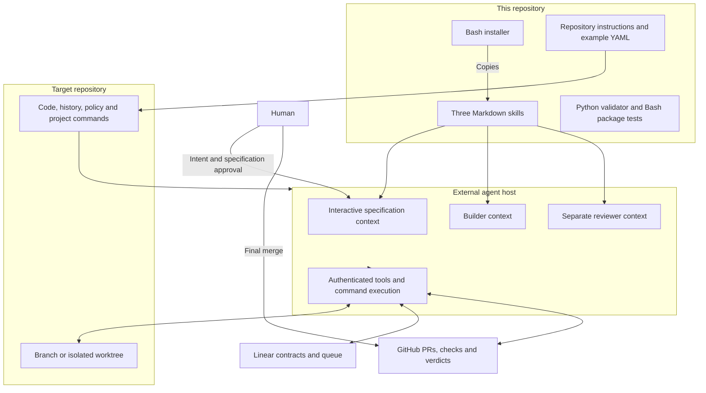

# Architecture

Audited baseline: [`ce6567c`](https://github.com/awekisa/ai-build-loop/tree/ce6567c886732da67189967571958ac7ddc298b7), 2026-09-22. All 16 tracked files and the three reachable commits were inspected. This document distinguishes executable code from instructions followed by the external host.

## Components and boundaries

The copy destinations are `.agents/skills` for Codex/OpenClaw and `skills/software-development` inside the supplied Hermes home. Each skill is Markdown with name/description frontmatter. `agents/openai.yaml` supplies display names and invocation prompts. These files contain no model client or running agent process.

The installer copies repository policy and example YAML only for Codex/OpenClaw, only if absent. It checks all existing skill directories before copying any skill, but has no transactional rollback after an interrupted copy. It does not authenticate services, create labels, configure branch protection, or register scheduled jobs. Hermes requires repository policy/configuration setup separately.

## Information flow

1. **Specification:** read code, tests, history, `AGENTS.md`, and `.ai-loop.yaml`; verify GitHub/Linear access; interview the human. The contract contains problem, `AC-N`, `NG-N`, constraints, relevant files, tests, verification, and dependencies. Oversized work becomes ordered issues with blocker relations.
2. **Approval:** the human approves issue creation and separately approves the exact filed contract. The spec agent does not self-apply `agent-ready`. There is no separate approval database.
3. **Selection and claim:** repairs take priority. Otherwise select an unassigned, ready, unblocked issue by priority then age; assign it to the authenticated user, move it to the started state, and re-fetch. No atomic compare-and-set or distributed lock is implemented.
4. **Implementation:** fetch the real default branch, create/resume an issue-named branch, edit, and execute relevant configured commands. The host reads durable context rather than receiving a serialized inter-agent handoff.
5. **PR handoff:** link `Closes ISSUE-ID`, map acceptance criteria and non-goals to evidence, record verification and risk, link back to Linear, and move to the configured review state.
6. **Independent review:** a separate context reads the contract and full diff, required checks, and mergeability. Re-fetch the head before posting `Loop review of COMMIT_SHA`. Labels encode pass, repair, or escalation.
7. **Human merge:** no agent role may merge, enable auto-merge, or deploy. Optional external Linear–GitHub synchronization may update issue state; no merge handler ships here.

## Persistent state

| State | Location | Limit |
| --- | --- | --- |
| Intent, scope, non-goals, dependencies | Linear body, comments, relations | No immutable snapshot of the approved issue body |
| Readiness and ownership | Linear labels, assignee, state | No package-level lock or lease |
| Source changes and local progress | Branches, commits, checkout/worktree | No crash checkpoint or automatic dirty-tree recovery |
| Review version and findings | PR comments, head SHA, labels | Repair count reconstructed from review/repair history |
| Validation and merge state | GitHub checks and repository settings | Settings can drift from local YAML |
| Commands, identifiers, policy | Target instructions and configuration | No full configuration parser/schema validation |
| Conversation | Agent host | Interaction history, not the authoritative queue |

No embedded database, vector store, internal job queue, or hidden memory service is present.

## Failure and recovery paths

| Condition | Prescribed response | Boundary |
| --- | --- | --- |
| Missing configuration or unreachable integration | Resolve configuration/access before work | Host acts on instructions |
| Dirty checkout | Report paths and stop; preserve unrelated work | No automatic stash/reset |
| Ambiguous or contradictory contract | Ask a specific decision question, add `blocked`, unassign | Human resolves scope |
| Required check fails or merge conflicts | Review records `[CI]` or `[DEFECT]`; in-scope repair can follow | Repair executed by host |
| Checks/mergeability pending or unknown | Report waiting without changing labels | A later invocation retries |
| No required CI | Set `needs-human-review`, remove automated verdict labels | Optional passing CI cannot bypass the gate |
| Head changes during review | Discard review and re-review | SHA check is instructed, not service-enforced |
| Repair changes scope or reaches budget | Set `needs-human-review`, leave repair queue | Default `max_fix_rounds` is 2 |
| Host crash, uncertain API outcome, interrupted install | No general recovery algorithm specified | Inspect durable state before resuming |

The repair budget concerns reviewed PR cycles; there is no universal counter or backoff for every local test/tool failure. The builder diagnoses failures during implementation, but no deterministic validation-until-success engine exists.

## Verification boundary

[`validate-skills.py`](../scripts/validate-skills.py) checks file presence, restricted frontmatter shape, naming, selected policy phrases, and UI prompt references. It uses text parsing rather than a YAML library. [`test-loop.sh`](../scripts/test-loop.sh) checks shell syntax, installs three temporary platform layouts, compares copied skills, and expects a repeat Codex installation to fail. [GitHub Actions](../.github/workflows/validate.yml) runs these tests on PRs and pushes to `main`.

These checks do not exercise Linear claims, policy compliance, independent review, repair limits, voice approval, live host compatibility, or merge restrictions. Target projects supply their own checks through `commands`. This repository's `typecheck` command is the structural validator, not a static type-checker.

## Generic and repository-specific pieces

The skills and installer are generic. `.ai-loop.yaml` identifies this repository, the author's Linear team, and package checks. The example replaces GitHub with a placeholder but retains the team key. Selection filters by team/readiness, without an enforced repository field or project filter. The host must reconcile the explicit target with issue context; see [gaps](gaps.md) before sharing a team across repositories.
