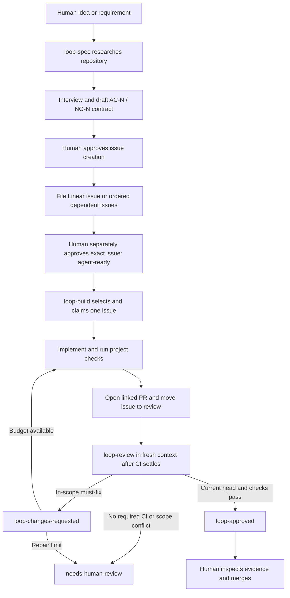

# Workflow contract

This describes the instructions in the three shipped skills. The host agent performs the work through its tools; no autonomous workflow service is bundled. For the observed downstream run and its deviations, see the [demo](demo/README.md).

## From intent to merge

Large requirements are decomposed during specification into focused issues with explicit blockers. There is no separate automatic task-planner service between specification and build. Each build/review invocation ends after one unit; repetition depends on another invocation or an external scheduler.

## Human-control boundaries

1. **Before filing:** show the full contract and obtain approval to create the issue. Issue creation is not implementation approval.
2. **Before queue entry:** the human separately approves the filed issue by exact identifier. The integration can then apply `agent-ready`; the specification agent cannot infer approval.
3. **During execution:** material ambiguity, conflicting acceptance criteria/non-goals, or changed scope returns to a person. Do not accept side-channel scope changes; amend and reapprove the issue.
4. **After escalation:** `needs-human-review` is persistent. A person resolves the stated reason and explicitly removes the gate before automated work resumes.
5. **Before merge:** a human checks the current head against the reviewed SHA, required CI, mergeability, verdict, and outstanding gates, then decides whether to merge. Agents never merge, enable auto-merge, or deploy.

These boundaries are instructions. Host permissions and GitHub protection supply any mechanical enforcement; the package does not provision them.

## Durable authorities

| Concern | Authority |
| --- | --- |
| Outcome, acceptance criteria, non-goals, dependencies | Linear issue |
| Readiness, blocked state, assignment and blocker relations | Linear |
| Code, head SHA, checks, conflicts, review verdict and merge | GitHub PR |
| Commands, identifiers and agent policy | Target `AGENTS.md` and `.ai-loop.yaml` |
| Human conversation and voice | Control surface; no replacement for durable work records |

## Build and repair selection

Repair the least recently updated eligible `loop-changes-requested` PR first, excluding `needs-human-review`. Read its linked issue and latest verdict, fix only must-fix items, validate, push, remove the repair label, and record evidence. Fresh review must follow the new head.

If no repair is available, choose a Linear issue in the configured team that is ready, unassigned, not blocked, and has no unresolved blockers. Sort by priority then age. Assign, move to the started state, and re-fetch before working. One builder per Linear team is an operating constraint, not an atomic lock. The post-claim eligibility wording and repository routing limitations are recorded in [gaps](gaps.md).

A dirty checkout stops normal build preflight. Preserve unrelated work. Any deliberate parallel work requires isolated worktrees, without overriding the one-builder-per-team rule.

## Review outcomes

| Situation | Required response |
| --- | --- |
| Checks/mergeability pending or unknown | Report waiting; do not change labels |
| Current SHA already has a verdict label and matching review comment | Skip that review under the selection rule |
| Head changes while reviewing | Discard the review; review the new head |
| In-scope must-fix, failed required CI, or conflict | `loop-changes-requested`; remove `loop-approved` |
| Scope conflict or no required checks | `needs-human-review`; remove both automated verdict labels |
| Required checks pass, clean merge, no must-fix | `loop-approved`; remove repair label; preserve any unresolved human gate |

Every verdict records `Loop review of COMMIT_SHA`, CI, mergeability, must-fix findings, non-blocking findings, and whether evidence supports a human merge decision. The reviewer cannot be the builder conversation. Posting a verdict comment is not a formal independent GitHub approval.

The configured repair limit is two rounds by default, reconstructed from PR verdict/repair history. It is not a global retry counter for all commands. Scope changes, product decisions, or budget exhaustion require a human. `blocked` removes a Linear issue from the build queue until the question is resolved and the label removed.

## Voice and scheduling

Voice policy requires repeating the exact identifier, title, and action before an external mutation and obtaining an explicit command tied to that identifier. Record resulting approval/state in Linear or GitHub. Generic agreement does not substitute for identified approval. Voice merging is disabled by default; no voice recognizer is implemented here.

An external host scheduler may invoke build/review, with one builder per team and a fresh review context. The package installs no schedule. Specification remains interactive. If a run is interrupted or a remote write has an uncertain outcome, inspect durable state before resuming; a general recovery algorithm remains unimplemented.
